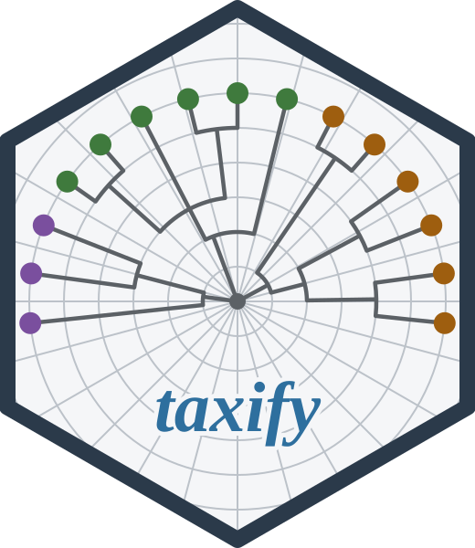

# taxify 

*species names matched to their accepted names, offline*

<!-- badges: start -->

[](https://CRAN.R-project.org/package=taxify)
[](https://cran.r-project.org/package=taxify)
[](https://cran.r-project.org/package=taxify)
[](https://github.com/gcol33/taxify/actions/workflows/R-CMD-check.yml)
[](https://app.codecov.io/gh/gcol33/taxify)
[](https://opensource.org/licenses/MIT)
<!-- badges: end -->

taxify matches taxonomic names, such as a field survey’s species list or
the species column of a trait table, to the name each taxon currently
carries, its accepted name.

The package performs the name-resolution step of
[taxize](https://docs.ropensci.org/taxize/) and
[WorldFlora](https://cran.r-project.org/package=WorldFlora), run offline
against local backbone files. A backbone is a published taxonomic
database, such as the Catalogue of Life or World Flora Online,
downloaded once and stored on your disk. Each name comes back with its
accepted name, how it was matched, and the backbone version that matched
it, so you can review the uncertain matches and decide which to keep.
taxify supports:

- **Backbones for every group.** taxify reads
  <!-- manifest:backbone-count -->19<!-- /manifest:backbone-count -->
  taxon backbones: global checklists (Catalogue of Life, GBIF, ITIS,
  NCBI, Open Tree of Life) and the authorities of single groups (World
  Flora Online, WoRMS, Species Fungorum, AlgaeBase, FishBase, the Mammal
  Diversity Database, AviList and others), all returning the same
  columns. Several backbones form a fallback chain, so a name one
  backbone lacks is matched by the next.

- **Published data on the accepted name.** Trait, status and
  distribution datasets,
  <!-- manifest:enrichment-count -->109<!-- /manifest:enrichment-count -->
  of them, from the IUCN Red List to seed mass and fish morphology, are
  joined by the accepted name, so a dataset that writes a synonym still
  lines up.
  [`add_trait()`](https://gillescolling.com/taxify/reference/add_trait.html)
  gathers one trait from every dataset that carries it.

- **Checking a list.**
  [`inspect()`](https://gillescolling.com/taxify/reference/inspect.html)
  returns only the names that need a look (typos, outdated synonyms,
  spellings shared by several taxa, unknown genera, an animal in a plant
  list), each with the name to use.

- **Vegetation units.** Two vegetation classifications, the
  EuroVegChecklist and the Czech national classification, resolve
  alliance and association names the way species names are resolved.

The accepted name is the backbone’s own, and where backbones disagree,
`mode = "wide"` shows each one’s answer side by side. Every row records
the backbone and its version, `cite()` prints the references of every
backbone and dataset a result used, and `taxify_lock()` saves the
versions so the analysis can be rerun on the same data. A script in the
repository matches 300 World Flora Online names in taxify and in
WorldFlora; 277 get the same accepted name, and [Compatibility with
taxize and
WorldFlora](https://gillescolling.com/taxify/articles/migration.html)
shows where and why the others differ.

## Installation

``` r
install.packages("taxify")

# or the development version
# install.packages("pak")
pak::pak("gcol33/taxify")
```

`install_backbones()` downloads the Catalogue of Life (COL), the GBIF
Backbone Taxonomy and the Integrated Taxonomic Information System
(ITIS), about 1.1 GB in all, and `taxify()` reads them from disk after
that. `taxify_clean()` removes them again.

## Usage

1.  Match the names with `taxify()`.

2.  Look at the matches that need a decision with `inspect()`.

3.  Join data on the accepted name with `add_data()` for your own table,
    or with an `add_<source>()` function for a published dataset.

``` r
library(taxify)

names <- c("Quercus robur", "Quercus robus", "Pinus abies",
           "Fallopia japonica")
res <- taxify(names)
#> Matching 4 names against 3 backbones: col -> gbif -> itis
#>   [col] Matching 4 names...
#>   [gbif] Matching 1 remaining names...
#>   [itis] Matching 1 remaining names...
#>   [col] Fuzzy matching 1 unmatched...
#>   [gbif] Skipped (all names matched)
#>   [itis] Skipped (all names matched)
#> Warning: 1 of 4 names resolve to more than one accepted ID (Pinus abies).
#> `accepted_id` holds one and `accepted_ids` all of them; list them with
#> taxify_ids() before requesting data by ID.
res[, c("input_name", "accepted_name", "match_type", "is_synonym")]
#>          input_name       accepted_name match_type is_synonym
#> 1     Quercus robur       Quercus robur      exact      FALSE
#> 2     Quercus robus       Quercus robur      fuzzy      FALSE
#> 3       Pinus abies         Picea abies      exact       TRUE
#> 4 Fallopia japonica Reynoutria japonica      exact       TRUE
#> Sources: COL 2026.09 | cite() for full citations
```

*Quercus robur* is matched as written. *Quercus robus* has a typo and
reaches *Q. robur* by fuzzy matching, which compares it with the names
of its own genus. *Pinus abies* and *Fallopia japonica* are outdated
synonyms of *Picea abies* and *Reynoutria japonica*. The warning names
an input whose spelling belongs to more than one accepted taxon; the
`n_ids` and `accepted_ids` columns count and list them.

The input is a character vector of names. Authors, qualifiers such as
`cf.` and `agg.`, capitals and an abbreviated genus are handled before
matching. Without `backbone`, every installed backbone is tried in a
fixed priority order, starting with the Catalogue of Life;
`backbone = c("wfo", "col")` names the chain.

``` r
inspect(res)
#> ── taxify inspection ──────────────────────────────────────────
#>   4 names inspected  |  3 with anomalies
#>   backbones: col, gbif, itis
#>   review: 2   note: 1
#>   ────────────────────────────────────────────────────────────
#>   [review] Pinus abies        ->  Picea abies          ambiguous (targets: 4HPZF|8K9Y|6BRMR|4HQ4F); outdated synonym
#>   [review] Quercus robus      ->  Quercus robur        likely misspelling
#>   [note  ] Fallopia japonica  ->  Reynoutria japonica  outdated synonym
```

`inspect()` labels each name with a tier: `review` for a match you have
to decide on, `note` for a change you can accept. [Get
started](https://gillescolling.com/taxify/articles/taxify.html) follows
a longer list to a table with traits attached.

## Joining data

`add_data()` matches the names of your own table against the same
backbones and joins on the accepted name. Each published dataset has its
own function, named after its source:

``` r
res |> add_data("my_traits.csv")
res |> add_iucn() |> add_eive()
res |> add_trait("seed_mass")
```

`list_enrichments()` lists every published dataset with its version,
size and source, and [Attaching published
data](https://gillescolling.com/taxify/articles/enrichments.html) shows
the joins in full.

## Choosing backbones

Each backbone is downloaded once, as a file built by the companion
package [taxifydb](https://github.com/gcol33/taxifydb), and pinned by
version. A vector of backbones forms a fallback chain: every backbone is
asked for an exact match before any is asked for a fuzzy one.

``` r
taxify(names, backbone = c("wfo", "col"))
```

`list_backbones()` reports each backbone’s scope, size, version and
whether it is installed. [Choosing and combining
backbones](https://gillescolling.com/taxify/articles/backbones.html)
covers the choice per group, downloads and version pinning, and [The
backbones and
datasets](https://gillescolling.com/taxify/articles/databases.html)
describes each one.

## Exploring the backbone

The backbone files also answer lookups by synonym, rank and lineage:

``` r
synonyms("Picea abies")                     # every synonym of a name
children("Quercus")                         # the species of a genus
upstream("Quercus robur", to = "family")    # the family of a name
sci2comm("Quercus robur")                   # common names
parse_name("Quercus robur (L.) H.Karst.")   # genus, epithet, author
```

[Exploring the
backbone](https://gillescolling.com/taxify/articles/exploring.html)
shows these and the other lookup functions.

## Large lists

Names are matched in C through
[vectra](https://gillescolling.com/vectra/), the column-store package
taxify reads its backbone files with. A fuzzy match compares a name only
with the names of its own genus. [Matching large
lists](https://gillescolling.com/taxify/articles/large-scale.html) gives
timings for lists up to 100,000 names.

## Documentation

Start with [Get
started](https://gillescolling.com/taxify/articles/taxify.html): one
path from a messy list to accepted names with traits attached.

- [Choosing and combining
  backbones](https://gillescolling.com/taxify/articles/backbones.html):
  which backbone for which group, fallback chains, versions.

- [Checking a name
  list](https://gillescolling.com/taxify/articles/inspecting-names.html):
  every label of `inspect()`, and `reconcile()` for a checklist.

- [Matching within a
  region](https://gillescolling.com/taxify/articles/regions.html):
  preferring the species that occur where the list was made.

- [Attaching published
  data](https://gillescolling.com/taxify/articles/enrichments.html) and
  [Joining your own
  data](https://gillescolling.com/taxify/articles/custom-data.html): the
  two kinds of join.

- [Exploring the
  backbone](https://gillescolling.com/taxify/articles/exploring.html):
  synonyms, children, classification and common names.

- [Requesting GBIF data for a species
  list](https://gillescolling.com/taxify/articles/gbif-requests.html):
  from matched names to an occurrence download.

- [Matching vegetation
  units](https://gillescolling.com/taxify/articles/vegetation-units.html):
  alliances and associations against the EuroVegChecklist.

- [Matching large
  lists](https://gillescolling.com/taxify/articles/large-scale.html):
  timings, memory, and long lists run in parts.

- [How names are
  matched](https://gillescolling.com/taxify/articles/fuzzy-matching.html)
  and [Hybrids and
  aggregates](https://gillescolling.com/taxify/articles/hybrids-and-aggregates.html):
  the matching rules in detail.

- [Compatibility with taxize and
  WorldFlora](https://gillescolling.com/taxify/articles/migration.html):
  agreement with WorldFlora, function mapping and timings.

- [The backbones and
  datasets](https://gillescolling.com/taxify/articles/databases.html):
  every backbone and dataset with its version, licence and reference.

- [Full reference](https://gillescolling.com/taxify/reference/): every
  function, grouped by job.

## Getting help

Questions and bug reports go to the [GitHub
issues](https://github.com/gcol33/taxify/issues). A bug report is
easiest to act on with a small reproducible example, for instance made
with [reprex](https://reprex.tidyverse.org/).

## Contributing

Pull requests are welcome; see the [contributing
guide](https://gillescolling.com/taxify/CONTRIBUTING.html).

## Support

> “Software is like sex: it’s better when it’s free.” — Linus Torvalds

I’m a PhD student who builds R packages in my free time because I
believe good tools should be free and open. I started these projects for
my own work and figured others might find them useful too.

If this package saved you some time, buying me a coffee is a nice way to
say thanks. It helps with my coffee addiction.

[](https://buymeacoffee.com/gcol33)

## Acknowledgements

The backbones and datasets are the work of the institutions and authors
who compile and publish them; `cite()` lists the reference for each one
a result used.

## License

taxify is licensed under MIT. Each backbone and dataset keeps the
licence of its publisher, listed in [The backbones and
datasets](https://gillescolling.com/taxify/articles/databases.html).

## Citation

If you use taxify, please cite the package and the backbones and
datasets your results come from. cite() on a taxify result lists their
references.

``` text
Colling G (2026). _taxify: Offline Taxonomic Name Matching Against
Darwin Core Backbones_. doi:10.32614/CRAN.package.taxify
<https://doi.org/10.32614/CRAN.package.taxify>. R package version
0.7.0, <https://gillescolling.com/taxify/>.
```

BibTeX:

``` bibtex
@Manual{colling2026taxify,
  title = {taxify: Offline Taxonomic Name Matching Against Darwin Core Backbones},
  author = {Gilles Colling},
  year = {2026},
  note = {R package version 0.7.0},
  doi = {10.32614/CRAN.package.taxify},
  url = {https://gillescolling.com/taxify/},
}
```

Download the citation as
[BibTeX](https://gillescolling.com/taxify/taxify.bib) or
[RIS](https://gillescolling.com/taxify/taxify.ris).
